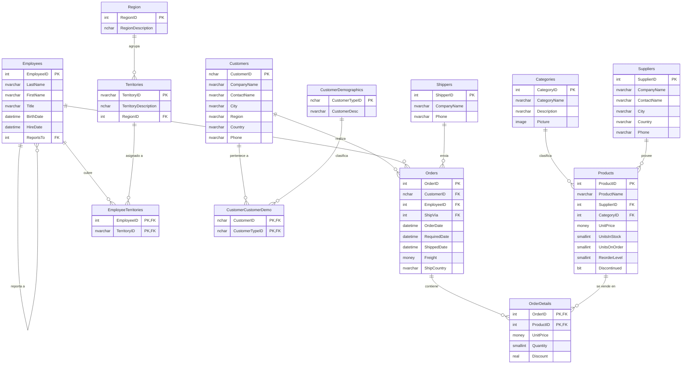
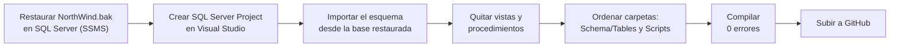
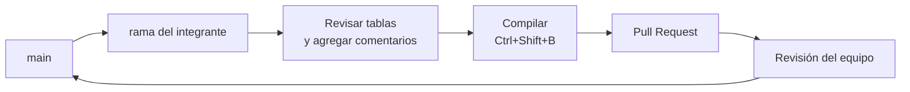

# NorthWind: SQL Server Project (OLTP)

Proyecto de base de datos de la tarea **"Diseño e implemento un modelo de base de datos"**.
Se eligió la base **NorthWind** y se implementó en un **SQL Server Project** de Visual Studio, **solo con el esquema de tablas (sin datos)**.

## Contenido

1. [Qué incluye el proyecto](#qué-incluye-el-proyecto)
2. [Estructura del repositorio](#estructura-del-repositorio)
3. [Diagrama entidad-relación](#diagrama-entidad-relación)
4. [Cómo se construyó el proyecto](#cómo-se-construyó-el-proyecto)
5. [Cómo trabajó el equipo](#cómo-trabajó-el-equipo)
6. [Cómo abrir y compilar el proyecto](#cómo-abrir-y-compilar-el-proyecto)
7. [Integrantes](#integrantes)

---

## Qué incluye el proyecto

| Elemento | Detalle |
|---|---|
| Base de datos | NorthWind |
| Tipo de proyecto | SQL Server Database Project (`.sqlproj`) |
| Tablas | 13, con clave primaria, claves foráneas, restricciones CHECK, valores por defecto e índices |
| Datos | No incluidos (la consigna no los pide) |
| Vistas y procedimientos almacenados | No incluidos: el trabajo se enfoca en las tablas |

## Estructura del repositorio

La estructura sigue la que mostró el profesor en la sesión sincrónica (`BikeStoresBI`).

```
NorthWindBI
 ├─ NorthWindBI.slnx                  Solución de Visual Studio
 └─ NorthWindOLTP
     ├─ NorthWindOLTP.sqlproj         Proyecto SQL Server
     ├─ Schema
     │   └─ Tables                    Un script .sql por tabla (13)
     └─ Scripts
         └─ NorthWind_Schema.sql      Script de apoyo con el esquema completo (no se compila)
```

Al abrir `NorthWindBI.slnx` en Visual Studio, la solución muestra además las carpetas virtuales `Databases > DataWarehouse / OLTP`, `ETL` y `OLAP`. Solo `OLTP` contiene un proyecto. Las demás quedan preparadas para etapas posteriores de BI.

## Diagrama entidad-relación

El diagrama se genera automáticamente en GitHub a partir del código Mermaid. Por legibilidad se muestran las claves y los campos principales; las tablas completas están en `Schema/Tables`.



### Cómo leer el diagrama

- **Pedidos:** un cliente realiza varios pedidos (`Orders`); cada pedido lo atiende un empleado, lo envía una empresa de transporte y tiene varias líneas en `OrderDetails`.
- **Productos:** cada producto pertenece a una categoría y lo provee un proveedor. `OrderDetails` es la tabla intermedia entre pedidos y productos.
- **Empleados:** un empleado puede reportar a otro (relación consigo misma) y cubre uno o más territorios; los territorios pertenecen a una región.
- **Clientes:** `CustomerCustomerDemo` es la tabla intermedia entre clientes y sus tipos demográficos.

## Cómo restaurar el NorthWind.bak 

**Desde SQL Server Management Studio (SSMS):**
1. Conectarse a la instancia de SQL Server.
2. Clic derecho en **Databases** > **Restore Database...**
3. Elegir **Device** y pulsar **...** > **Add** y seleccionar el archivo `NorthWind.bak`.
4. Verificar que el nombre de destino sea `NorthWind` y pulsar **OK**.

## Cómo se construyó el proyecto



1. **Restaurar la base:** se restauró `NorthWind.bak` en SQL Server con SSMS.
2. **Crear el proyecto:** en Visual Studio se creó una solución `NorthWindBI` con un proyecto `NorthWindOLTP` del tipo *SQL Server Database Project*.
3. **Importar el esquema:** clic derecho en el proyecto, *Importar > Base de datos*, con estructura por tipo de objeto.
4. **Depurar:** se eliminaron las vistas y los procedimientos almacenados. Hacían referencia a una tabla llamada `[Order Details]` (con espacio) que en esta base se llama `OrderDetails`, lo que generaba 42 errores de compilación. Como la tarea se centra en las tablas, se descartaron.
5. **Ordenar:** se movieron las tablas a `Schema/Tables` y se creó `Scripts` con el script de apoyo `NorthWind_Schema.sql` (acción de compilación: *Ninguno*). Se crearon las carpetas de solución `Databases/OLTP`, `ETL` y `OLAP` como en el ejemplo del profesor.
6. **Compilar:** el proyecto compila con 0 errores y 0 advertencias.
7. **Publicar:** se subió a este repositorio de GitHub.

## Cómo trabajó el equipo

Se usó un flujo con ramas y Pull Requests para que cada integrante revisara solo sus tablas sin pisar el trabajo de los demás.



### Reparto de tablas

| Integrante | Tablas | Rama |
|---|---|---|
| 1 | Orders, OrderDetails, Shippers | `tablas-pedidos` |
| 2 | Customers, CustomerCustomerDemo, CustomerDemographics | `tablas-clientes` |
| 3 | Employees, EmployeeTerritories, Territories, Region | `tablas-empleados` |
| 4 | Products, Categories, Suppliers | `tablas-productos` |

### Tareas de cada integrante

1. Clonar el repositorio y crear su rama desde `main`.
2. Abrir su script en `Schema/Tables` y compararlo con el diagrama: clave primaria, claves foráneas, restricciones e índices.
3. Agregar al inicio de cada script un comentario con el propósito de la tabla y sus relaciones.
4. Compilar antes de subir.
5. Hacer `commit`, `push` y abrir un Pull Request hacia `main`.

### Reglas acordadas

- Nadie sube directo a `main`: todo pasa por Pull Request.
- Cada integrante modifica solo los archivos de sus tablas, para evitar conflictos.
- No se cambian los nombres de las tablas (por ejemplo, la tabla de líneas de pedido se llama `OrderDetails`, sin espacio).
- Se hace `git pull origin main` antes de empezar a trabajar.

### Comandos usados

```bash
git clone https://github.com/rspm48/northwind-sql-project.git
cd northwind-sql-project
git checkout -b tablas-clientes        # cada integrante usa su propia rama
# ... revisar y comentar las tablas, compilar ...
git add .
git commit -m "Revisión de tablas de clientes"
git push origin tablas-clientes
# luego, en GitHub: abrir el Pull Request hacia main
```

## Cómo abrir y compilar el proyecto

**Requisitos:** Visual Studio con el componente *SQL Server Data Tools* (carga de trabajo *Almacenamiento y procesamiento de datos*).

1. Clonar el repositorio:
   ```bash
   git clone https://github.com/rspm48/northwind-sql-project.git
   ```
2. Abrir `NorthWindBI/NorthWindBI.slnx` en Visual Studio.
3. Compilar con **Ctrl+Shift+B**. Debe terminar sin errores.

No hace falta tener la base de datos instalada para compilar el proyecto.

## Integrantes

| Integrante | Nombre | Usuario de GitHub | Tablas a cargo |
|---|---|---|---|
| Integrante 1 | `Enrique Arce Alejandro` | `ingenriquearce` | Orders, OrderDetails, Shippers |
| Integrante 2 | `Telassim Ginnola Gomez Jimenez` | `Ginnola` | Customers, CustomerCustomerDemo, CustomerDemographics |
| Integrante 3 | `Edgar Polanco Ochoa` | `edgarpolanco17 ` | Employees, EmployeeTerritories, Territories, Region |
| Integrante 4 | `Rosario Scarlett Prado Mendoza` | `rspm48` | Products, Categories, Suppliers |

